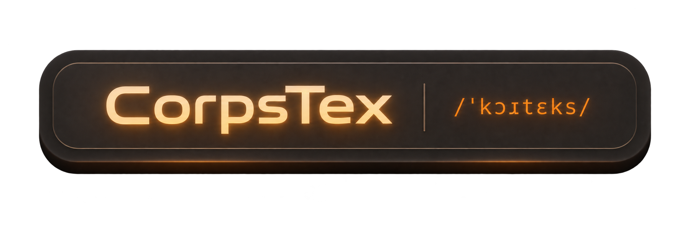

  

  A Linux desktop interface for <a href="https://github.com/openai/codex">Codex</a> and <a href="https://opencode.ai/">OpenCode</a>.

  <a href="https://github.com/M0KA907/CorpsTex/releases">Releases</a> ·
  <a href="https://github.com/M0KA907/CorpsTex/issues">Issues</a> ·
  <a href="LICENSE">License</a>

---

### Overview

CorpsTex combines coding-agent conversations, project files, and development tools in a customizable Linux desktop application.

### Features

- **Projects & sessions** — Work across projects with organized conversations and session tabs.
- **Files & editor** — Browse and edit project files without leaving the workspace.
- **Agent activity** — Follow streaming responses, tool output, and execution history.
- **Permissions** — Review agent actions through a central approval interface.
- **Appearance** — Customize themes, colors, and typography.

### Installation

CorpsTex provides **Linux x86_64** builds as an Arch Linux package, AppImage, and portable archive.

**[Get CorpsTex from GitHub Releases](https://github.com/M0KA907/CorpsTex/releases)**

> [!IMPORTANT]
> Install and configure [Codex](https://github.com/openai/codex) or [OpenCode](https://opencode.ai/) separately. CorpsTex uses the existing runtime on your system.

<strong>Available package formats</strong>

- **Arch Linux:** `.pkg.tar.zst`
- **AppImage:** `.AppImage`
- **Portable:** `.tar.gz`

Choose a package from the Releases page that matches your system.

### Project status

> [!NOTE]
> CorpsTex is in active development. Some runtime capabilities are not yet supported in the desktop interface.

Bugs and feature requests can be tracked through [GitHub Issues](https://github.com/M0KA907/CorpsTex/issues).

---

  Linux · Codex / OpenCode · <a href="LICENSE">GPL-3.0</a>

