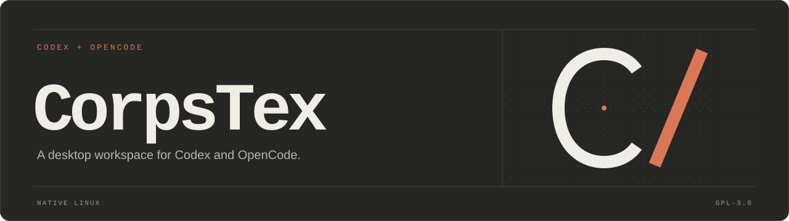

  

  A native Linux desktop interface for <a href="https://github.com/openai/codex">Codex</a> and <a href="https://opencode.ai/">OpenCode</a>.

  <a href="https://github.com/M0KA907/CorpsTex/releases">Releases</a> ·
  <a href="https://github.com/M0KA907/CorpsTex/issues">Issues</a> ·
  <a href="LICENSE">License</a>

---

### Overview

CorpsTex brings coding-agent conversations, project files, and development tools into a customizable desktop workspace.

**Features**
- Multi-project workspace with session tabs
- Integrated file explorer and code editor
- Streaming conversations and tool activity
- Permission management and execution history
- Custom themes, typography, and appearance
- Integration with system-installed Codex and OpenCode

### Installation

Available for **Linux x86_64** as an Arch package, AppImage, or portable archive.

[**Download from GitHub Releases**](https://github.com/M0KA907/CorpsTex/releases)

Requires an independently installed and configured Codex or OpenCode runtime.

---

  Open source · GPL-3.0 · Linux

